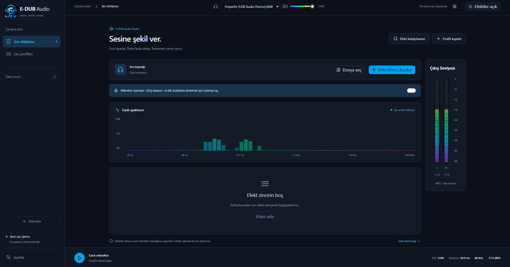

# E-DUB Audio

Windows için Türkçe ses işleme uygulaması, sürüm 0.5.1. React + TypeScript, Tailwind CSS 4, shadcn/ui yaklaşımıyla Radix tabanlı erişilebilir bileşenler ve Electron kullanır.



## İndir

Windows x64 kurulum dosyası: [Son sürüm](https://github.com/Nergal-exe/E-DUB-Audio/releases/latest).

Türkçe kullanım rehberi: [Programın amacı ve tüm özellikleri (PDF)](docs/E-DUB-Audio-Amac-ve-Ozellikler.pdf).

## Lisans

Proje [GNU GPL v3](LICENSE.txt) lisansıyla yayımlanır. Üçüncü taraf bileşenlerin kendi lisansları [THIRD-PARTY-NOTICES.md](THIRD-PARTY-NOTICES.md) içinde belirtilmiştir.

## Çalıştırma

```powershell
npm ci
npm run dev
```

Masaüstü uygulaması: `npm run desktop`

Windows Setup oluşturma: `npm run dist:win` (çıktı: `release/`). Paket imzalı değildir.

PDF kullanım rehberini yeniden üretme: `npm run guide` (çıktı: `docs/E-DUB-Audio-Amac-ve-Ozellikler.pdf`). Sürüm `package.json`, efektler `src/effects.ts`, ekran görüntüsü `docs/images/e-dub-audio-studio.png` dosyasından alınır. Python 3 ve `pip install reportlab` gerekir.

## Özellikler

- Mikrofon giriş kazancı 0–24 dB; varsayılan +6 dB. Dosya sesini değiştirmez. Giriş kazancından sonra -1 dB örnek tepe koruması uygulanır; daha sonraki efektlerin kazancı ayrıca ayarlanmalıdır.
- Efektler zincirden kaldırılıp kütüphaneden tekrar eklenebilir. Kapalı efekt ile kaldırılmış efekt ayrı tutulur; zincir ve sıralama kaydedilir.
- Hakkında yalnızca Ayarlar içinde yer alır; yan menüdeki yinelenen bağlantı kaldırılmıştır.

- 31 kategorili efekt girişi: parametrik ekolayzır, filtre, bas, harmonik, dinamik, gürültü temizleme, stereo, alan ve perde işlemcileri.
- Frekans / Q / kazanç / filtre tipi / ön kazanç ayarlı 10 bant. 1–10 filtreli parametrik Equalizer APO / AutoEQ metin içe aktarma (PK, LS, HS). GraphicEQ ve keyfi APO komutları desteklenmez; sınırı aşan profiller reddedilir.
- WAV/OGG/FLAC IR yükleme: en fazla 10 saniye ve 25 MB. IR oturumluk saklanır, yeniden açılışta Convolver kapalıdır.
- Cihazda çalışan gerçek RNNoise WASM ve DeepFilterNet3 WASM; modeller paketlenir, ses dışarı gönderilmez.
- Dosya veya canlı mikrofon kaynağı. Mikrofon kulaklık izlemesi varsayılan kapalıdır. Echo Canceller, mikrofon yakalamasında WebRTC yankı önlemeyi kullanır; ayar değişince yakalama yeniden açılır.
- Gerçek ses verisinden canlı spektrum, efekt bypass ve çıkış seviyesi.
- Dört hazır ekolayzır profili; tüm parametrik ayarları, efektleri ve zincir sırasını içeren özel profil kaydetme/silme. Eski kazanç profilleri taşınır.
- Kalıcı açık/koyu tema ve ses ayarları.
- Onay penceresiyle varsayılana dönüş; kayıtlı profiller korunur.
- Ayarlar içinde Hakkında ve marka adı açıklaması.
- Sağlanan Logo.png tabanlı uygulama simgesi ve Windows ICO. Yeniden üretmek için `node scripts/icons.mjs`.

## Ayarlar

- **Genel:** tema, Windows girişinde otomatik başlatma, pencere kapanınca tamamen çıkma veya sistem tepsisine gizleme, gizli başlangıç. Tepsi simgesi uygulamayı geri açar; menüden tamamen çıkılabilir. Otomatik başlatma yalnızca paketlenmiş uygulamada çalışır; taşınabilir EXE taşınırsa ayarı yeniden kapatıp açın. Mikrofon girişte kendiliğinden açılmaz.
- **Ses ve performans:** mikrofon kazancı, spektrum alt/üst frekansı, 10/15/30/60 FPS, atıllık süresi, tampon/gecikme hedefi. Çizim gizli pencerede durur, aktif ses yokken 1 FPS'e düşer. Atıllıkta yalnız dosya durduysa ve mikrofon kapalıysa AudioContext askıya alınır; yeniden oynatma uyandırır. Açık mikrofon sessizlik nedeniyle kesilmez.
- **Tampon sınırı:** 128–2048 örnek seçimi AudioContext latencyHint isteğidir; gerçek tampon Windows/Chromium tarafından belirlenir. Mevcut motor yeniden açılınca uygulanır. Quantum 128 örnek, örnekleme 48 kHz sabittir. Panelde temel gecikme gösterilir; efekt ve donanım gecikmelerini içermez.
- **Cihazlar ve ön ayarlar:** giriş/çıkış aygıtı seçimi, cihaz algılama, cihaz/profil kuralları; seçilen veya yeni bağlanan cihaz için ilk eşleşme uygulanır. Cihaz ayrıldığında son profili koruma veya belirli bir profile dönme. Cihaz adları izin gerektirebilir; algılama için açılan mikrofon hemen durdurulur.
- **Muafiyetler:** dosya/mikrofon adı içinde büyük-küçük harf duyarsız eşleşme, bu kaynakta efekt zincirini atlar. Kaynak kazancı ve çıkış sesi korunur. **Uygulama adına göre sistem çapında muafiyet uygulanmaz**: bu kurallar kaydedilir ancak henüz sistem ses yönlendirme motoru yoktur. UI bunları pasif olarak gösterir.
- **Veri yönetimi:** doğrulanan JSON veritabanını içe/dışa aktarma; içe aktarma öncesi profil/kural sayısı ve değiştirme onayı. Ses ayarları, profiller, cihaz kuralları, muafiyetler dahil; ses/IR dosyaları ve Windows başlangıç tercihleri hariç. Başka bilgisayarda cihaz kimlikleri yeniden eşleştirilmelidir.
- **Hakkında:** programın amacı ve E-DUB Audio isminin açıklaması.

Varsayılan ayarlara dönüş, ses ve arayüz tercihlerini, cihaz kurallarını ve muafiyetleri sıfırlar. Kaydedilmiş profiller ve Windows başlangıç/kapanış tercihleri korunur.

## Kapsam

Windows genelindeki diğer uygulamaların sesini yakalamaz. Sistem çapında Easy Effects benzeri kullanım için WASAPI/sanal ses aygıtı veya APO tabanlı ayrı bir yerel ses motoru gerekir. Çıkış Windows'un varsayılan ses aygıtını kullanır.

Genel ayarlar, profiller ve tema localStorage içinde saklanır. IR dosyası profillere gömülmez; yeniden seçilir. Dosyalar bir sunucuya gönderilmez.

### Algoritma sınırları

- Autotune, deneysel E-DUB otokorelasyon/granular perde düzelticisidir. **x42-plugins entegrasyonu yoktur**; x42 için yerel LV2 sunucusu gerekir. Tek sesli vokal içindir, formant korumaz.
- Pitch Shift çift okuma kafalı granular işlemdir; süreyi korur, artefakt üretebilir.
- Noise Reduction 32 bantlı eşik azaltma, Deep Noise Remover gerçek DeepFilterNet3, RNNoise gerçek konuşma gürültü modelidir. Neural efektler mono/48 kHz çalışır.
- Voice Suppressor stereo merkez çıkarır; kaynak ayırma değildir. RNNoise ile farklı amaç taşır.
- Crystalizer yüksek frekans geçişlerini vurgular; kayıp codec verisini geri getirmez.
- Multiband dinamik işlemciler 250 Hz / 2.5 kHz üç bant ayırma kullanır. Bağımsız eşik, ortak oran veya azaltma.
- Limiter 5 ms ileri bakışlı örnek tepe sınırlayıcıdır; true-peak değildir. Ardına eklenen kazanç/efektler tavanı aşabilir. Son sıraya koyun.
- Maximizer kazanç + sınırlama yapar; dinamiği azaltabilir. Autogain RMS tabanlıdır; LUFS değildir.
- Level Meter çıkış sesinden sonra örnek tepe/RMS dBFS ölçer; zincirdeki görünür sırasından bağımsız son noktayı ölçer.
- Crosstalk Canceller basit gecikmeli ters çapraz beslemedir; oda/hoparlör kalibrasyonu yapmaz.

### Üçüncü taraf bileşenler

DeepFilterNet3: `@lofcz/deepfilternet-web` 0.1.0, MIT/Apache-2.0. RNNoise: `@shiguredo/rnnoise-wasm` 2025.1.5, Apache-2.0 sarmalayıcı ve BSD-3-Clause RNNoise. Lisanslar `public/vendor` altında dağıtılır. `scripts/vendor.mjs`, DeepFilterNet worklet'ine Chromium UTF-8 uyumluluğu, hazır/hata bildirimi ve kaynak bırakma ekler.

Easy Effects projesi iş akışı referansıdır; kaynak kodu veya görselleri kopyalanmamıştır: https://github.com/wwmm/easyeffects

## Kontrol

`npm run build` TypeScript kontrolünü ve üretim derlemesini çalıştırır.

`scripts/smoke.mjs`: tema, profil, sıfırlama, bilgi, oynatma, mobil. `scripts/effects-test.mjs`: 31 giriş, motor başlatma, WASM işleme, AutoEQ doğrulama ve sentetik mikrofon. Bu testler çalışan `npm run dev` sunucusu ve Microsoft Edge gerektirir.

`node scripts/dsp-test.mjs`: sayısal DSP testleri (limiter tavanı/impuls, gate, çok bant birleşimi, stereo/merkez, perde, bit derinliği, gürültü azaltma).

`scripts/native-test.mjs`: paketlenmiş Windows uygulamasında çevrimdışı modeller ve sentetik mikrofon testi. Fiziksel mikrofon, akustik yankı kalitesi ve tüm gerçek ses kaynakları için kalite garantisi yerine geçmez.

`node scripts/run-browser-tests.mjs scripts/settings-test.mjs scripts/smoke.mjs scripts/effects-test.mjs` sunucuyu başlatır, tarayıcı testlerini çalıştırır ve sunucuyu kapatır. Ayar testleri +6 dB mikrofon kazancını sayısal ölçer; cihaz geçişi, JSON veritabanı, efekt kaldırma, atıllık ve mobil görünümü doğrular.

`scripts/lifecycle-test.mjs`: Windows başlangıç IPC argümanları (gerçek login kaydı değiştirilmeden mock ile), kapatınca tepsiye gizleme, tekrar açma, gizli başlangıç ve tamamen çıkış. Yalıtılmış test profili kullanır.


## 0.3.1 düzeltmeleri

- Cihaz taraması sırasında mikrofon, liste alınana kadar açık tutulur ve hata dahil her durumda kapatılır. Mikrofon açılamasa da erişilebilen çıkış cihazları listelenir; sonuç ve hata mesajı ayarlar içinde gösterilir.
- Electron çıkış cihazı seçme izni eklendi. Kamera izni verilmez.
- Muafiyet formu dosya akışıyla başlar, Enter ve düğmeyle ekler, yinelenen kuralları engeller ve sonucu gösterir. Eşleşen kaynakta sinyal göstergesi Bypass gösterir.
- Sistem geneli ses motoru bulunmadığından uygulama adı muafiyetleri desteklenmez. Bu seçenek devre dışıdır; daha önce kaydedilen kurallar silinmez.
- `node scripts/run-browser-tests.mjs scripts/device-fallback-test.mjs scripts/settings-test.mjs`: mikrofon izni reddi, kaynak temizliği ve ayar regresyonları.
- `node scripts/device-regression.mjs`: gerçek Windows cihazlarıyla tarama ve muafiyet formu testi. `EDUB_EXE` ortam değişkeni ile paketlenmiş uygulama da test edilir.

## 0.4.0 izleme arayüzü

Üst çubukta çıkış aygıtı ve ses seviyesi; sağ panelde bağımsız L/R örnek tepe göstergeleri; renkli ekolayzır grafiği. Alt çubuk E-DUB Audio işlem CPU kullanımını, AudioContext temel gecikmesini (efekt gecikmeleri hariç), gerçek örnekleme hızını ve çıkış tepe dBFS değerini gösterir. Tarayıcıda CPU ölçümü mevcut değildir ve çizgi gösterilir.

`node scripts/run-browser-tests.mjs scripts/stereo-test.mjs` bağımsız sol/sağ ölçümleri doğrular. `scripts/monitor-ui-test.mjs` Windows CPU verisi ve yeni yerleşimi kontrol eder. Native testlerden önce üretim derlemesini/paketini oluşturun.

## 0.4.1

Canlı spektrum, stereo ölçerler ve ses göstergeleri ekolayzırın mor–turkuaz–yeşil–sarı–pembe paletini paylaşır. Çıkış aygıtı ve ses seviyesi başlık çubuğuna taşındı. Hakkında menüsü Hakkında olarak adlandırıldı.

## 0.5.0 Setup

`release/E-DUB Audio Setup <sürüm>.exe` x64 kurucusu uygulamayı Program Files altına, tüm kullanıcılar için kurar. Yönetici izni gerekir. Windows Ayarlar → Uygulamalar üzerinden kaldırılabilir. Kaldırma, mevcut kullanıcının kayıtlı uygulama verilerini ve başlangıç kaydını temizler; güncelleme verileri korur. Dışa aktarılmış yedekler ve kullanıcının ses/IR dosyaları korunur. Test kapsamı ve sınırları TEST-REPORT.md içindedir.

## 0.5.1

Hata düzeltmeleri:
- Sayı alanlarına (ön kazanç, bant frekansı, Q, spektrum aralığı, atıllık süresi) ara değerler ve negatif sayılar yazılabilir; değer odak kaybında sınırlara uydurulur.
- Mono dosyalarda sağ kanal göstergesi artık doğru ölçer; çıkış stereoya açılır.
- Yüklenemeyen bir AI efekti (DeepFilterNet/RNNoise) zincirin geri kalanını kilitlemez; efekt kapatılır ve nedeni bildirilir.
- Uygulamanın ikinci kopyası pencere veya ikinci tepsi simgesi oluşturmadan kapanır.
- Profil silme onay ister; silinen profile bağlı cihaz kuralları ve varsayılan profil ayarı temizlenir.
- Hakkında: ad açıklaması düzeltildi (Sümerce é “ev” + dub “tablet” → É-DUB “tablet evi”).

Yenilikler:
- Ekolayzır grafiği 10 bandın gerçek birleşik frekans yanıtını logaritmik eksende gösterir; noktaya tıklayarak bant seçilir. Toplam kazanç 0 dB'i aşarsa kırpılma uyarısı ve tek tıkla ön kazanç düzeltmesi.
- Oynatma çubuğu: süre, konum sarma ve döngüde çalma.
- Ses dosyasını pencereye sürükleyip bırakma.
- Kısayollar: Boşluk oynat/duraklat (mikrofonda kulaklık izleme), ←/→ 5 sn sarma.
- Efekt zincirinde kategori simgeleri; spektrum ölçümünde gereksiz yeniden çizimler azaltıldı.
